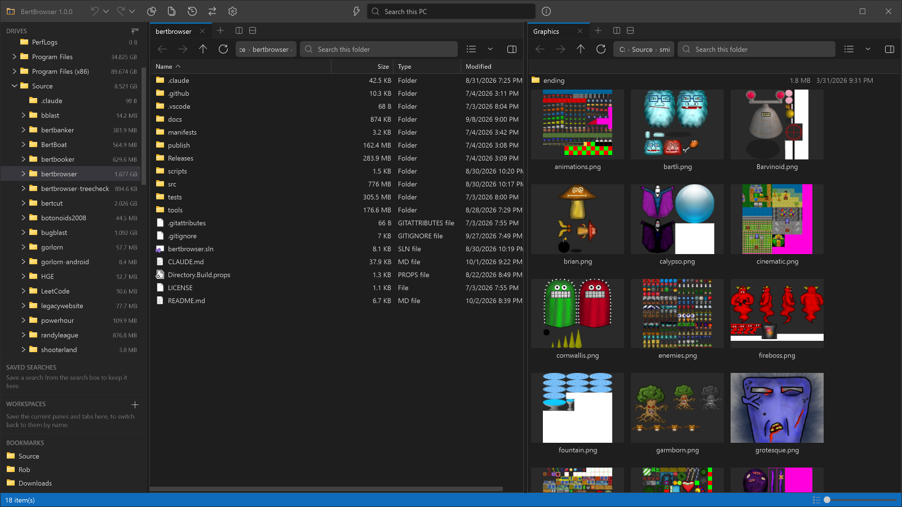
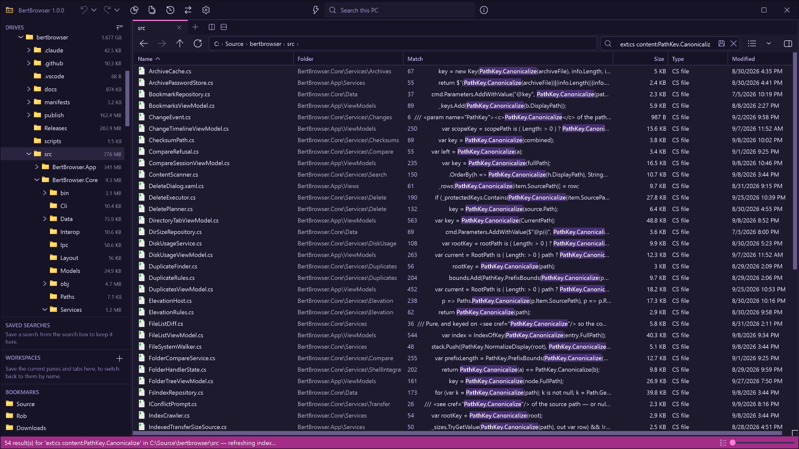
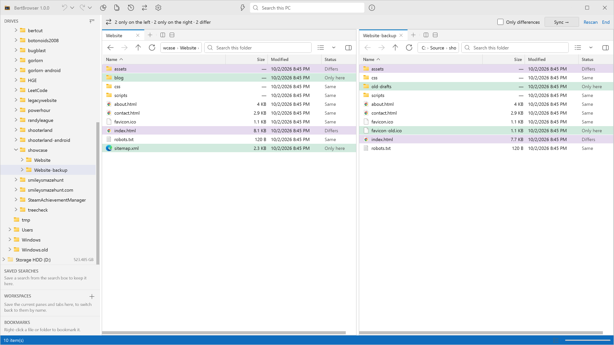
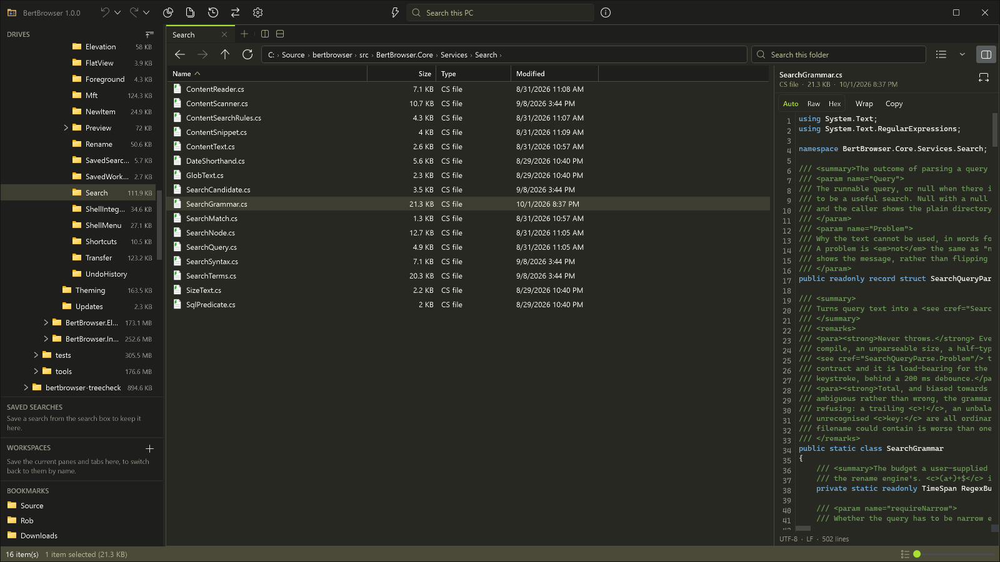
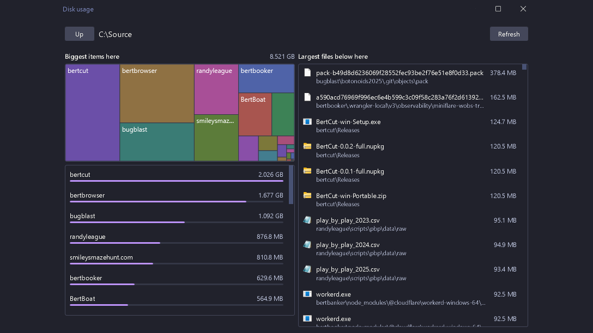
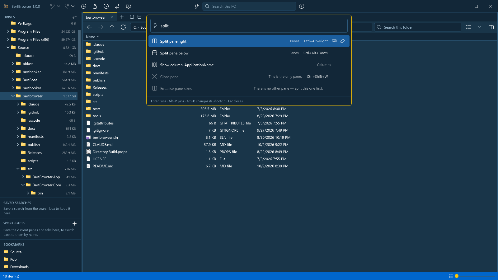

# bertbrowser

[](https://github.com/robgwalsh/bertbrowser/releases/latest)
[](https://github.com/robgwalsh/bertbrowser/releases/tag/unstable)
[](https://github.com/robgwalsh/bertbrowser/actions/workflows/unstable.yml)

A [fast and memory-efficient](native/docs/performance.md) offline Windows 10/11 file browser.

- **Offline** - BertBrowser does not connect to the Internet except a startup check against [GitHub Releases](https://github.com/robgwalsh/bertbrowser/releases) for app updates.
- **[Instant global search](docs/search-indexing.md)** - MFT indexing and USN journal tracking for fastest possible performance.
- **Directory sizes** — Show total size on directories, just like files.
- **Split panes with tabs** - Infinite pane splitting and tabs per pane.
- **Tree Map browser by filesize** - Visualize recursive directory sizes, easily find whats taking the most space.
- **Rich Preview Panel** - Inline media playback, syntax highlighting in text, hex viewer
- **Tools** - Find duplicates, compare files and directories, track file system changes, and more!
- **Customizable** - Customizable command palette, menus, toolbars, browser columns, context menus, themes; saved workspaces and searches.

<table>
<tr>
<td width="50%" align="center" valign="top">
<a href="docs/images/split-panes.png?raw=true"></a>
</td>
<td width="50%" align="center" valign="top">
<a href="docs/images/search.png?raw=true"></a>
</td>
</tr>
<tr>
<td align="center" valign="top">
<a href="docs/images/compare.png?raw=true"></a>
</td>
<td align="center" valign="top">
<a href="docs/images/preview-pane.png?raw=true"></a>
</td>
</tr>
<tr>
<td align="center" valign="top">
<a href="docs/images/disk-usage.png?raw=true"></a>
</td>
<td align="center" valign="top">
<a href="docs/images/command-palette.png?raw=true"></a>
</td>
</tr>
</table>

## Install

```powershell
winget install RobWalsh.BertBrowser
```

* **Or** grab the [latest installer](https://github.com/robgwalsh/bertbrowser/releases/latest/download/BertBrowser-win-Setup.exe) and run it.
* **Or** download the [latest portable executable](https://github.com/robgwalsh/bertbrowser/releases/latest/download/BertBrowser-win-Portable.zip) if you'd rather not install anything.

Windows 10/11, x64. Nothing else to install: the app is native, with no .NET runtime and no Visual C++
redistributable.

### Unstable

The latest code in `main`, rebuilt and published on every push. It gets the same test suite a release
gets and none of the settling time.

* Grab the [unstable installer](https://github.com/robgwalsh/bertbrowser/releases/download/unstable/BertBrowser-unstable-Setup.exe), or the [unstable portable build](https://github.com/robgwalsh/bertbrowser/releases/download/unstable/BertBrowser-unstable-Portable.zip).

It **replaces an installed copy** rather than sitting beside it, and from then on that copy updates
along unstable instead of along releases. Help ▸ About says which you are on, as does the taskbar — `BertBrowser 2.0.1-unstable.42`
against `BertBrowser 2.0.0`. Your data in `%USERPROFILE%\.bertbrowser` is untouched either way, and
running the [stable installer](https://github.com/robgwalsh/bertbrowser/releases/latest/download/BertBrowser-win-Setup.exe)
over the top puts you back.

## Building and running

Needs Visual Studio 2022 with the *Desktop development with C++* workload, Rust stable
(`x86_64-pc-windows-msvc`) and `cargo install cbindgen`.

```powershell
git clone https://github.com/robgwalsh/bertbrowser.git
cd bertbrowser\native

pwsh .\build.ps1                  # build (add -Config release for a release build)
cargo test --workspace            # run the Rust tests
```

Warnings are errors on both sides (clippy `-D warnings`, MSVC `/W4 /WX`), so a clean build is a
warning-free build. The app lands in `native\out\<config>\app\BertBrowser.exe`.

See [docs/build-and-release.md](docs/build-and-release.md) for packaging, the tag-driven release workflow, and how updates reach installed copies.

## Testing the interface

`native/harness` builds `bb-harness.exe`, which allows testing BertBrowser in a headless way: it links the
app's own UI library and Rust core, shows the real main window parked outside every monitor and refused
activation, then drives it with a small script language and captures it through Direct2D on the WARP
software rasteriser - so being offscreen and covered costs nothing.

```powershell
$harness = "native\out\debug\harness\bb-harness.exe"

& $harness --script tools\ui\smoke.bbs --out $env:TEMP\look-1     # browse, search, move, rename, delete, undo
& $harness --script tools\ui\themes.bbs --out $env:TEMP\look-2    # every built-in theme, and the dialogs
& $harness --script tools\ui\tree.bbs --out $env:TEMP\look-3 --sandbox C:\Source\treecheck --allow-outside
& $harness -c "tree .; refresh; shot look" --out $env:TEMP\look-4 # ad hoc; prints the PNG path
& $harness --help
```

Each run gets a throwaway fixture tree and its own scratch data directory (`BERTBROWSER_DATA_DIR`), so it
never touches your real index, settings or themes. It starts no programs, never touches the clipboard,
and refuses to write outside its sandbox — the harness drives the real transfer, rename and delete
executors, not stubs.

## Benchmarking

`bb-bench` (`native/crates/bb-bench`) benchmarks the core, whole UI scenarios and startup. Results are
compared against a committed per-machine baseline, CI gates allocations on every push, and
[native/docs/performance.md](native/docs/performance.md) is generated from the baselines. See
[native/bench/README.md](native/bench/README.md).

```powershell
$bench = "native\target\release\bb-bench.exe"
& $bench run --filter *fsindex*          # a core area
& $bench ui --scenario listing-10k       # a UI scenario, five fresh processes
& $bench compare --baseline native\bench\baselines\<key>.json --current native\bench-results\current.json
```

## Data locations

| What | Where |
|---|---|
| Size-cache + search-index database | `%USERPROFILE%\.bertbrowser\bertbrowser.db` |
| Window/session settings | `%USERPROFILE%\.bertbrowser\settings.json` |

Delete the folder to reset the app completely. Data left by the 1.x (C#) versions is moved into
`%USERPROFILE%\.bertbrowser\legacy-<date>\` on the first 2.x launch, never deleted.

## Project layout

- `native/crates` — the Rust core: `bb-paths` (path keys), `bb-core` (everything testable and UI-free:
  SQLite persistence, search, executors, undo, metadata, archives), `bb-shell` (shell/registry/COM
  services), `bb-app` (orchestration), `bb-ffi` (the C ABI), the two elevated helpers `bb-indexer` and
  `bb-elevator`, and `bb-bench`.
- `native/app` — the C++20 Win32 + Direct2D/DirectWrite UI, custom-drawn.
- `native/harness` — the offscreen UI harness; `tools/ui/*.bbs` are its scripts.
- `native/bench` — benchmark baselines and notes.
- `csharp/` — the frozen C#/WPF app of the 1.x releases, kept as a behavioural reference. Not built or shipped.

See [CLAUDE.md](CLAUDE.md) for a deeper architecture walkthrough (path-key invariants, the FFI rules, the size-scan algorithm).

## License

[MIT](LICENSE). Third-party components are listed in [THIRD-PARTY-NOTICES.md](THIRD-PARTY-NOTICES.md).
